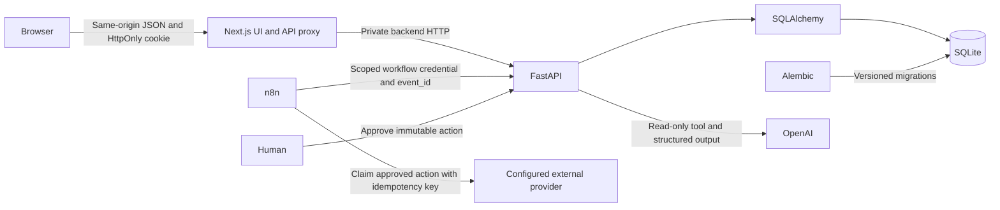

# MarketPilot AI architecture

The application uses two independent repositories as requested. Clone them side by side; repository roots correspond to `frontend/` and `backend/` in the original brief. The original brief is preserved in `docs/project-brief.md`; this document describes the implementation.

Next.js checks the session on protected dashboard entry. FastAPI independently authenticates and authorizes every data endpoint. Cookies are HttpOnly, SameSite=Lax, expire after 24 hours by default, and must be Secure in production. Only a SHA-256 hash of a random 48-byte session token is stored. Logout revokes that session immediately; a password change revokes all sessions and gives the current browser a fresh one. Passwords use Argon2 through pwdlib. Email is normalized and unique.

The browser calls a same-origin Next.js proxy; the backend URL and OpenAI key are server-only configuration. The proxy forwards only the session cookie and supported API methods. Mutations require an exact configured Origin. FastAPI requires a custom CSRF header and rejects untrusted browser origins. CORS is an additional browser control, never an authorization substitute. Workflow routes instead require a separate revocable, hashed credential and are excluded from the browser proxy.

Every Client belongs to a User; Leads, Campaigns, Content, and Reports belong to a Client. Nested routes verify both the user and parent client. Relationships and foreign keys support cascading deletion. UTC timestamps are restored explicitly when SQLite returns timezone-naive values. Numeric money fields use Decimal in storage and input validation. Use one currency consistently per client; no currency conversion is implemented.

AI agents share a read-only `get_client_context` tool constrained by the already authenticated client. The context contains business description, campaign metrics, aggregate lead/content summaries, and the six most recent performance snapshots. It omits individual lead emails. First the provider requests this tool, then a structured Pydantic result is parsed and saved as a Report. External publishing and budget tools are never offered to the model. User-provided text is untrusted, and outputs always require human review. No live website crawler, competitor search, keyword feed, or RAG source is implemented; the research agent identifies hypotheses and research priorities from supplied information.

Webhook events have a unique `(user_id, event_id)` constraint and payload hash. An identical retry returns the original result; reuse with different data returns 409. The lead/report write and event receipt commit together. Publishing and budget requests store an immutable payload. A human must approve, an executor must claim, and a confirmed external receipt must complete the action. Editing cancels unclaimed approvals; claimed actions block edits/deletion. Executors must honor the returned provider idempotency key. The application cannot enforce exactly-once execution in a third-party provider that lacks idempotency support.

SQLite mutations to an existing client use a transaction lock before approval-sensitive reads. This is an initial single-instance deployment; migrate to PostgreSQL and a task queue before multi-instance operation or heavy AI workloads. AI provider calls are bounded, have no automatic retry, and are capped at 20 attempts per account per hour. Login attempts have persisted limits. Logs record request IDs, status, method, and duration without request bodies, cookies, or credentials.
